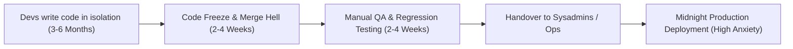
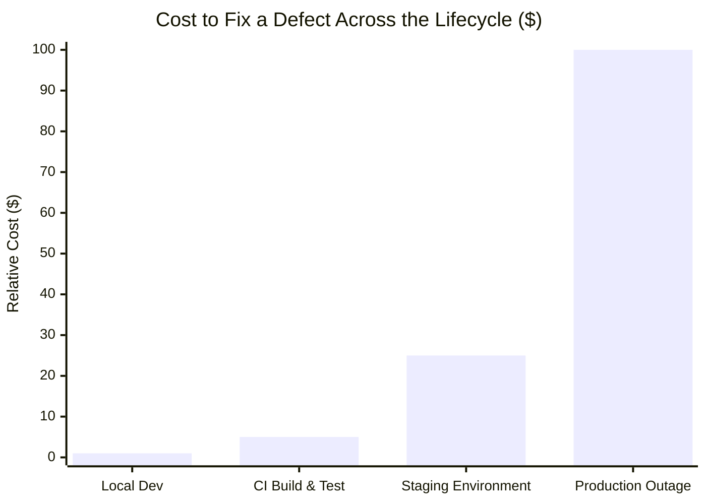
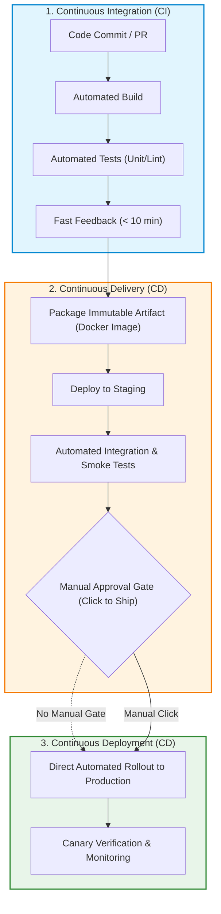

# 01. Why CI/CD Exists: The Roots of Modern Software Delivery

> **Milestone:** Phase 1 — Fundamentals & The "Why"  
> **Status:** Completed  
> **Draw.io Diagram:** [why-cicd.dio](file:///home/yossab/1-Project/CI-CD-learning/concepts/01-fundamentals/why-cicd/why-cicd.dio)  
> **Primary References:** [GitLab CI/CD Guide](https://about.gitlab.com/topics/ci-cd/), [The New Stack Primer](https://thenewstack.io/a-primer-continuous-integration-and-continuous-delivery-ci-cd/)

---

## 🏛️ 1. The Historical Crisis: The World Before CI/CD

To truly master CI/CD, we must step back in time. Why did the software industry spend billions transitioning to automated delivery pipelines? 

Before CI/CD became the standard, software followed the **Waterfall** model or fragmented Agile development. Teams operated under long release cycles (3 months, 6 months, or even a full year). The workflow looked like this:

This traditional approach suffered from three fatal engineering breakdowns:

### A. "Integration Hell" (جحيم الدمج)
When dozens of developers write code on isolated branches for weeks without merging to `main`:
- Each developer makes subtle assumptions about shared interfaces, schemas, and shared utilities.
- When the branches are finally merged on "Integration Day," Git cannot resolve hundreds of semantic and syntactic conflicts automatically.
- Code breaks everywhere. The team enters **"Integration Hell"**, spending weeks doing nothing but untangling merge conflicts and re-testing broken features.

### B. The Divergence Formula (Branch Drift)
The risk of merging two branches is not linear with time—it is **exponential**:

$$\text{Conflict Risk} \propto N \times T^2$$

Where $N$ is the number of active developers and $T$ is the time elapsed since the branch diverged from trunk. The longer a branch lives in isolation, the further reality drifts away underneath it.

### C. "Works on My Machine" (Environment Drift)
A feature works on the developer's laptop because:
- They have specific global Node.js packages installed.
- Their local PostgreSQL database has leftover experimental seed data.
- Their operating system (macOS/Windows) handles case-insensitive filenames, whereas production Linux is strictly case-sensitive.
When handed over to Ops to manually deploy via FTP, SSH, or ad-hoc bash scripts, the application crashes immediately in production.

---

## 📉 2. The Shift-Left Principle & The Cost of Defect Curve

One of the greatest discoveries in software engineering economics is the **Cost of Defect Curve** (originally formalized by Barry Boehm):

- **In Local Dev / CI:** A bug caught by a unit test during a Git push costs **1x** (3 minutes of developer time).
- **In Staging:** A bug caught in staging costs **25x** (requires bug ticket, investigation, coordination, new build).
- **In Production:** A bug reaching production costs **100x+** (downtime, customer churn, revenue loss, emergency hotfixes, brand damage).

CI/CD embodies **Shift-Left**: moving testing, security scanning, and verification as far to the left (closest to the initial commit) as humanly possible.

---

## ⚙️ 3. The Three Pillars Deconstructed

### 1. Continuous Integration (CI)
- **Rule:** Every developer pushes to the shared trunk daily.
- **Action:** An isolated runner checks out the commit, executes hermetic builds, and runs the automated test suite.
- **Outcome:** The codebase is proven to compile and pass tests at all times.

### 2. Continuous Delivery (CD)
- **Rule:** Every passing commit produces a deployable, immutable artifact.
- **Action:** The artifact is deployed and tested in non-production environments automatically.
- **Outcome:** Software is **always in a releasable state**. Pushing to production is a trivial business decision triggered with one click.

### 3. Continuous Deployment (CD)
- **Rule:** Zero human intervention between merge and production.
- **Action:** Every commit that passes the automated pipeline is released directly into production.
- **Prerequisites:** Extreme test confidence, synthetic health checks, automated canary traffic shifting, and instant auto-rollback.

---

## 💥 4. Production Horror Story: The Knight Capital Disaster (2012)

Why is automated, immutable deployment critical?
- On August 1, 2012, financial trading firm **Knight Capital** was deploying new trading software to 8 production servers.
- A systems engineer **manually copied the code to 7 servers, but forgot the 8th server**.
- When the market opened at 9:30 AM, an old, dead algorithm on the 8th server was accidentally triggered by new message flags. It began executing millions of errant buy and sell orders.
- In **45 minutes**, Knight Capital lost **$440 million** and went bankrupt.

**The CI/CD Lesson:**
Manual deployments are inherently error-prone. Production deployments must be **automated, orchestrated, hermetic, and verifiable**.

---

## 📈 5. The 4 DORA Metrics (Engineering Benchmarks)

According to the DevOps Research and Assessment (DORA) benchmarks from Google Cloud:

| Metric | Low Performers | Medium Performers | Elite Performers |
| :--- | :--- | :--- | :--- |
| **Deployment Frequency** | Monthly or yearly | Monthly to bi-weekly | Multiple deploys per day |
| **Lead Time for Changes** | 1 to 6 months | 1 week to 1 month | Less than 1 hour |
| **Mean Time to Recover (MTTR)** | Days or weeks | Days | Less than 1 hour |
| **Change Failure Rate** | 46% - 60% | 16% - 30% | 0% - 15% |

High-performing engineering teams do not sacrifice quality for speed; by using CI/CD, **speed and stability reinforce each other**.
