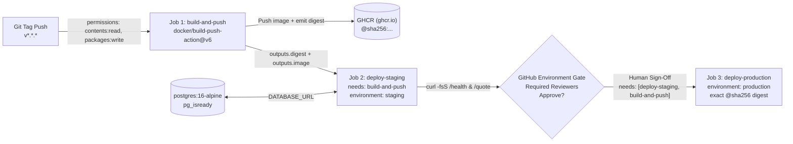

# 03. Continuous Delivery (CD): Immutable Releases, 12-Factor Config & Release Gates

> **Milestone:** Phase 3 — Continuous Delivery (CD)  
> **Status:** Mastered  
> **Draw.io Diagram:** [continuous-delivery.dio](file:///home/yossab/1-Project/CI-CD-learning/concepts/03-continuous-delivery/continuous-delivery/continuous-delivery.dio)  
> **Hands-On Lab:** [cd.yml](file:///home/yossab/1-Project/CI-CD-learning/.github/workflows/cd.yml) | [Dockerfile](file:///home/yossab/1-Project/CI-CD-learning/labs/01-node-service/Dockerfile) | [index.ts](file:///home/yossab/1-Project/CI-CD-learning/labs/01-node-service/src/index.ts)

---

## 🏛️ 1. Historical Context: Why Rebuilding on Deploy Day Fails at 3:00 AM

In traditional delivery pipelines, teams treated CI output (`dist/` or a zip archive) as an informal build artifact and ran separate build steps on Staging and Production (or re-ran `npm install && npm run build` directly on production servers). That pattern broke in three catastrophic ways:

1. **Silent Drift Between Staging and Production:** If Staging built at 10:00 AM and Production ran `npm install` at 4:00 PM after an upstream dependency published a broken patch—or if Production ran a different Node.js/OpenSSL version—the bytes deployed to Production were **never tested in Staging**.
2. **Broken 3:00 AM Rollbacks:** Rolling back by checking out an old Git commit and rebuilding from scratch fails whenever an upstream package registry, OS mirror, or build tool has changed since that commit was authored.
3. **Baked-In Secrets & Environment Coupling:** Shipping `.env` files inside build artifacts or images leaks database credentials to anyone with registry pull access and makes it impossible to promote the same artifact across environments.

**The Continuous Delivery Solution:** **Build Once, Deploy Anywhere.** Package the compiled code, production dependencies, and runtime into one immutable container image, address it by its cryptographic `@sha256:...` digest, inject `DATABASE_URL` at runtime via OS environment variables, verify it in Staging with deep health checks, and gate Production behind human approval.

---

## ⚙️ 2. Technical Anatomy of a Production CD Pipeline

### A. Tag-Driven Triggers & Least-Privilege `GITHUB_TOKEN`
- **SemVer Release Triggers:** Unlike CI (which runs on every branch `push` and `pull_request`), CD triggers strictly on versioned release tags (`on: push: tags: ["v*.*.*"]`) so routine development commits do not flood GHCR with unversioned release images.
- **Least-Privilege Permissions:** `GITHUB_TOKEN` is auto-minted per workflow run and expires immediately when jobs finish. Declaring `contents: read` + `packages: write` lets the runner check out the repository and push images to GHCR without granting write access to source code or exposing long-lived Personal Access Tokens (PATs).
- **Lowercase Repository Normalization:** Docker / GHCR require strictly lowercase image paths (`ghcr.io/${GITHUB_REPOSITORY,,}/pricing-service`).

### B. Build Once, Deploy Anywhere & Immutable Digest Bridging
- **Build Time vs. Runtime:** TypeScript compilation (`npm run build`) and `npm prune --omit=dev` execute **inside `docker build`** ([Dockerfile](file:///home/yossab/1-Project/CI-CD-learning/labs/01-node-service/Dockerfile)), never inside `CMD`. The finished image boots immediately with `CMD ["node", "dist/src/index.js"]`.
- **3-Hop Cross-VM Output Chain:** Because GitHub Actions jobs share zero disk or shell state across VMs:
  1. `docker/build-push-action@v6` (`id: build`) emits `digest` to `$GITHUB_OUTPUT`.
  2. `build-and-push` declares `outputs: { digest: ${{ steps.build.outputs.digest }}, image: ${{ steps.image.outputs.name }} }`.
  3. Downstream jobs list `build-and-push` in `needs:` and pull `${{ needs.build-and-push.outputs.image }}@${{ needs.build-and-push.outputs.digest }}`.
- **Critical `needs:` Rule:** In GitHub Actions, a job can only read `outputs` from **direct** entries in its `needs:` array. `deploy-production` must declare `needs: [deploy-staging, build-and-push]` so it both waits for Staging to pass and has direct access to `build-and-push`'s `digest`.

### C. 12-Factor Runtime Config & Environment Parity
- **OS-Level Secret Injection:** Never copy `.env` into Git or into a Docker image. Each job's `environment:` (`staging` vs. `production`) resolves its own `${{ secrets.DATABASE_URL }}` and injects it at container boot (`-e DATABASE_URL=...`), keeping the image completely secret-free.
- **Engine & Data-Scale Parity:** Staging runs the exact `postgres:16-alpine` engine used in CI and Production. Teams must also watch for **data-scale parity** gaps—a missing index or full-table scan that finishes in 2ms on 100 Staging rows can stall 10M Production rows.

### D. Deep Staging Smoke Tests & Production Approval Gates
- **Deep `/health` Probe (`SELECT 1`):** Returning a hardcoded `200 OK` from RAM hides broken `DATABASE_URL` credentials or unreachable Postgres sockets. [index.ts](file:///home/yossab/1-Project/CI-CD-learning/labs/01-node-service/src/index.ts) executes `SELECT 1` against `pg.Pool` and returns `503` if the database is unreachable.
- **Why `curl -fsS` (`--fail`) Matters:** Bare `curl` exits with code `0` even on `HTTP 500` responses. Adding `-f` forces `curl` to exit non-zero (`22`) on any `4xx`/`5xx` status, failing `deploy-staging` immediately before `deploy-production` can ever unlock.
- **`needs:` vs. `environment:`:** `needs:` controls **DAG execution order**; GitHub `environment: production` enforces **Deployment Protection Rules** (pausing the job until an authorized reviewer clicks **Approve and deploy**) and isolates Production secrets.

---

## 🔥 3. Real-World Production Case Study: Continuous Delivery vs. Continuous Deployment

At **Amazon** and **Netflix**, mature teams practice **Continuous Deployment** (every commit passing automated canary analysis promotes automatically), whereas regulated fintech, healthcare, and payment platforms often practice **Continuous Delivery**:
- Every tagged release builds once, pushes an immutable `@sha256` container image, and automatically deploys and smoke-tests in Staging.
- A human release owner—or business window check—clicks **Approve** on the `production` GitHub Environment gate to promote those exact verified bytes.
- If Production exhibits an unexpected regression post-release, rollback is a deterministic pointer flip back to the previous known-good `@sha256` digest in under 60 seconds—zero rebuilds required.

---

## 🧠 4. Socratic Review Quiz

1. Why does `deploy-production` in [cd.yml](file:///home/yossab/1-Project/CI-CD-learning/.github/workflows/cd.yml) specify `needs: [deploy-staging, build-and-push]` instead of `needs: deploy-staging` alone?
2. Suppose Staging uses `curl http://localhost:3000/health` (without `-f`), and `pricing-service` returns `500 Internal Server Error` because `DATABASE_URL` is wrong. What happens to the Staging job exit code—and why is that catastrophic?
3. Why is running `CMD ["sh", "-c", "npm run build && npm start"]` inside a production container a violation of **Build Once, Deploy Anywhere**?
